# Gapfill question type – user documentation

Applies to Gapfill 2.33 (Moodle 4.5 and later, including Moodle 5.x).

Gapfill is a fill-in-the-gaps (cloze) question type with a very simple syntax:
**put square brackets around the missing words**.

```
The [cat] sat on the [mat].
```

This creates a question with two gaps whose correct answers are `cat` and
`mat`. A gap can hold a single word or a phrase.

Contents

- [Installing](#installing)
- [Trying it out](#trying-it-out)
- [Example questions](#example-questions)
- [Creating a question](#creating-a-question)
- [Display answers: dragdrop, dropdown and gapfill](#display-answers-dragdrop-dropdown-and-gapfill)
- [Distractors](#distractors)
- [Delimit characters](#delimit-characters)
- [Question options](#question-options)
- [Gap settings (per-gap feedback)](#gap-settings-per-gap-feedback)
- [Regular expressions](#regular-expressions)
- [Gaps that may be left blank (`!!`)](#gaps-that-may-be-left-blank-)
- [No duplicates mode](#no-duplicates-mode)
- [Letter hints](#letter-hints)
- [Marking and feedback](#marking-and-feedback)
- [Answering a question](#answering-a-question)
- [In the Moodle app](#in-the-moodle-app)
- [Tables with category columns](#tables-with-category-columns)
- [Tables with images](#tables-with-images)
- [Gapfill crossword](#gapfill-crossword)
- [Extended characters](#extended-characters)
- [Site administration settings](#site-administration-settings)
- [Prevent typing into gaps](#prevent-typing-into-gaps)
- [Use in modules other than quiz](#use-in-modules-other-than-quiz)
- [Related question types](#related-question-types)

## Installing

Follow the standard Moodle
[Installing plugins](https://docs.moodle.org/en/Installing_plugins) process,
either from the plugins directory
(<https://moodle.org/plugins/qtype_gapfill>) or from source
(<https://github.com/marcusgreen/moodle-qtype_gapfill>).

For a manual install, place the files in

```
question/type/gapfill
```

under your Moodle web root, then visit **Site administration > Notifications**
to complete the installation.

## Trying it out

The README contains a *Preview in Moodle Playground* button. It opens a
complete Moodle site in the browser, with no local install, and boots into a
quiz called "Testing Gapfill!" that shows all three answer modes with sample
questions.

## Example questions

Over 500 example questions are available under a Creative Commons licence in
the `examples` folder of the plugin:

| File | Contents |
| --- | --- |
| `examples/en/gapfill_examples.xml` | Around 20 questions demonstrating the features of the question type |
| `examples/en/english_language.xml` | Questions for teaching English, in around 31 categories |
| `examples/en/gapfill_example_course.mbz` | A course backup containing example questions |
| `examples/el`, `es`, `fr`, `ja` | Translated versions of `gapfill_examples.xml` |

The XML files can be imported into any question bank using the standard
[Moodle XML import](https://docs.moodle.org/en/Import_questions).

Site administrators can also import the examples from
**Site administration > Plugins > Question types > Gapfill > Import**. Enter
the short name of the course to import into; a link to the imported
questions is shown when the import completes.

## Creating a question

1. In a question bank (or while editing a quiz) choose to create a new
   question and select **Gapfill**.
2. Enter the **Question text**, putting delimiters around each word or phrase
   that should become a gap, for example `The [cat] sat on the [mat]`.
3. Optionally add **Distractors** (wrong answers), **General feedback**, and
   per-gap feedback using **Gap settings**.
4. Under **More options** choose how answers are displayed and set any other
   options described below.
5. Save. The question must contain at least one gap, otherwise the form
   reports "You have not included any fields in your question text".

## Display answers: dragdrop, dropdown and gapfill

The **Display Answers** setting controls how students give their answers.

| Mode | What the student sees |
| --- | --- |
| **dragdrop** (default) | A shuffled list of answer options above (or below) the text. Options are dragged into the gaps, or selected and placed with a click, tap or the keyboard. |
| **dropdown** | Each gap is a dropdown list containing all the possible answers (correct answers plus distractors). |
| **gapfill** | Empty text fields with no list of options. The student types each answer. |

Options that do not apply to the selected mode are enabled or disabled
automatically on the editing form.

**dragdrop** mode, with the "How to answer" section expanded and two gaps
filled:

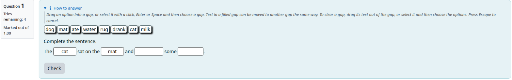

The same question in **dropdown** mode:

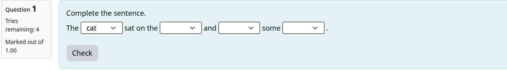

And in **gapfill** mode:

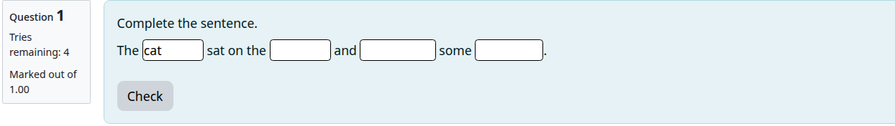

## Distractors

Distractors are wrong answers that are shuffled into the list of options in
dragdrop and dropdown modes. Enter them as a comma-separated list:

```
blue,shoe,small
```

If a distractor needs to contain a comma, escape it with a backslash: `\,`.

Distractors are not used in gapfill mode.

## Delimit characters

The default delimiters are square brackets `[ ]`. The **Delimit characters**
dropdown offers alternatives, which is useful when square brackets have a
meaning in the question itself, for example in programming questions:

| Delimiters | Example |
| --- | --- |
| `[ ]` | `The [cat] sat on the [mat]` |
| `{ }` | `The {cat} sat on the {mat}` |
| `# #` | `The #cat# sat on the #mat#` |
| `@ @` | `The @cat@ sat on the @mat@` |

The list of choices can be changed by a site administrator (see
[Site administration settings](#site-administration-settings)).

## Question options

These are found under **More options** on the editing form. Site-wide
defaults for most of them can be set by an administrator.

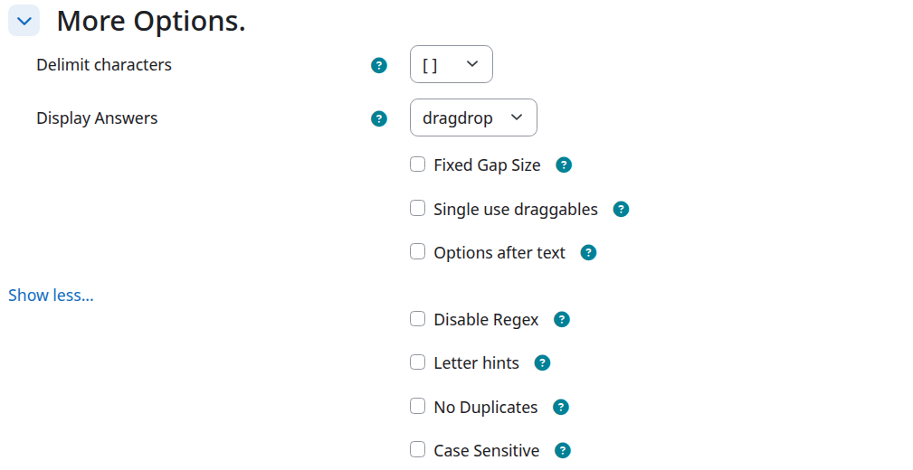

| Option | Description |
| --- | --- |
| **Fixed Gap Size** | Every gap is the same width as the widest gap. This stops gap size giving away the answer, e.g. with `[red]` and `[yellow]` it would otherwise be clear which word goes in the bigger gap. For a gap using the `\|` operator, the widest alternative is used. |
| **Single use draggables** | Dragdrop mode only. When an option is placed in a gap it is removed from the list, which simplifies choosing the remaining answers. Placed options keep their space so the layout does not jump. |
| **Options after text** | Dragdrop mode only. Shows the draggable answer options after the question text instead of above it. Useful when the gaps come at the end of a block of text: answers do not have to be dragged as far, and there is less scrolling on small screens. |
| **Disable Regex** | Turns off regular expression matching and uses a plain string comparison. See [Regular expressions](#regular-expressions). |
| **Letter hints** | In interactive mode, adds letters of the correct answer to incorrect gaps on each retry. See [Letter hints](#letter-hints). |
| **No Duplicates** | Only gives credit for the first occurrence of an answer. See [No duplicates mode](#no-duplicates-mode). |
| **Case Sensitive** | When checked, if the correct answer is `CAT` then `cat` is marked wrong. Off by default. |

## Gap settings (per-gap feedback)

Feedback can be given for an individual gap, separately for a correct and an
incorrect response.

1. Click the **Gap settings** button below the question text. The question
   text switches into settings mode.
2. Click on a delimited gap word. A popup form appears.
3. Enter **Feedback for correct** and/or **Feedback for incorrect** and close
   the popup.
4. Click **Gap settings** again to return to editing the question text.

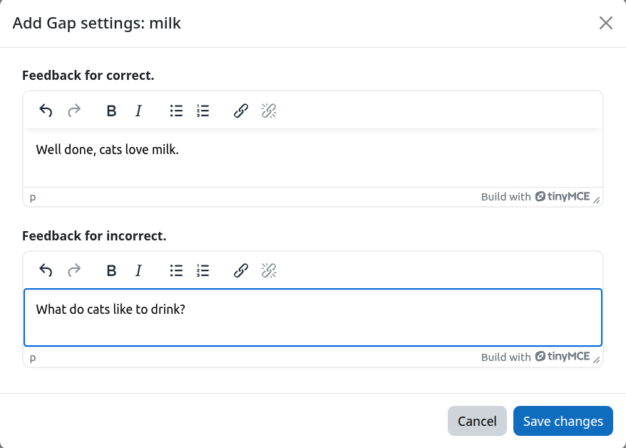

The Gap settings button is only available when your editor preference is
TinyMCE or Atto. Per-gap feedback is filtered through Moodle's HTML cleaning
before display.

## Regular expressions

Unless **Disable Regex** is set, each gap is treated as a regular expression,
which allows flexible marking.

| Gap | Accepts |
| --- | --- |
| `What [color\|colour] is the sky?` | `color` or `colour` (US and UK spellings) |
| `[cat\|dog]` | `cat` or `dog` |
| `What [c.*r] is the sky?` | Any answer starting with `c` and ending with `r` |
| `{cal[e\|a]ndar}` | `calendar` or the common misspelling `calandar` (note the `{ }` delimiters so the square brackets can be used inside the expression) |

The `|` (or) operator is the most commonly used. The question type does not
check that your regular expressions are valid. For more on regular
expressions in answers see the
[Preg question type](https://docs.moodle.org/en/Preg_question_type)
documentation.

### Disable regex

Turn regular expressions off when the answer text contains characters with a
special meaning in regular expressions, such as `< > * . / \`. This is often
the case in HTML or maths questions, where `<` and `>` or `*` should be
treated literally.

## Gaps that may be left blank (`!!`)

Two exclamation marks inside a gap mean "nothing". A gap containing `!!` is
marked correct if it is left empty.

```
The [cat] sat on the [!!]
```

This question is worth 2 marks; the student gets full marks by entering `cat`
and leaving the second gap blank.

Combined with `|`, a gap may accept either an answer or nothing:

```
[cat|dog|!!]
```

The maximum mark counts `!!` gaps, so that entering a value in a gap that
should be blank loses a mark. The example questions include one called
"Correct_empty_gaps with !!".

## No duplicates mode

Useful for questions of the form "Name three examples of ...", where each gap
accepts the same set of answers:

```
What are the colours of the Olympic medals?
[gold|silver|bronze] [gold|silver|bronze] [gold|silver|bronze]
```

With **No Duplicates** checked, if a student enters `gold` in every gap only
the first gets a mark. The duplicates are still shown with a tick but with a
yellow background, and the feedback says "Credit is partial because you have
duplicate answers". In effect duplicate answers are discarded for marking
purposes.

Use gapfill mode for this kind of question, otherwise the draggable options
will be confusing.

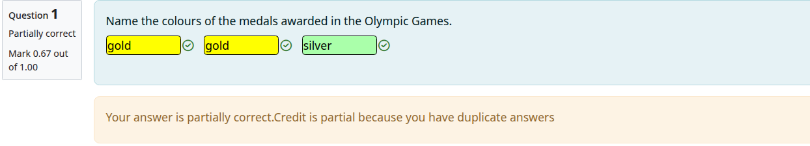

## Letter hints

Letter hints work with the **Interactive with multiple tries** question
behaviour, and require hints to be set up in the **Multiple tries** section
of the form.

- After the first incorrect submission, the first letter of the correct
  answer is added to each incorrect gap when the student presses
  **Try again**.
- After the next incorrect submission, the first two letters are added, and
  so on for as many hints as the question has.

For example, if the correct answer is `cat` and the student answers `dog`, on
the next try the gap contains `c`. If they then answer `mouse`, the gap
contains `ca`.

After the first wrong answer:

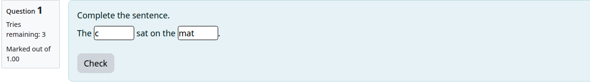

After the second wrong answer:

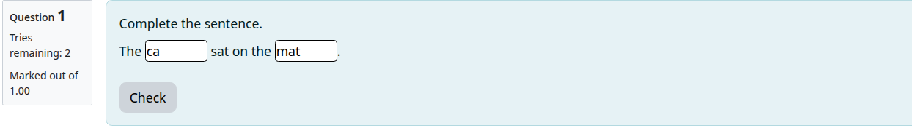

A site administrator can enable **Add hint text to editing form**, which fills
the first two hints in the Multiple tries section with text explaining this to
students.

## Marking and feedback

- Each correct gap is worth exactly 1 mark; marks are not weighted by answer
  length.
- There is no negative marking.
- Marking is case insensitive unless **Case Sensitive** is checked.
- Leading and trailing spaces in a response are ignored.
- The question supports the standard question behaviours (deferred feedback,
  interactive with multiple tries, immediate feedback, etc.), hints, and
  combined feedback.
- After submission each gap shows a green (correct) or red (incorrect)
  background, with a tick or cross once the question is finished. In
  interactive mode the feedback reports how many gaps were completed
  correctly, e.g. "You completed 3 gaps correctly out of 4."
- In interactive mode, to show this after each try, check **Show the number
  of correct responses** for the hints in the **Multiple tries** section.
  This does not reveal the correct answers; if you want students to see
  them, put the full text in the "For any partially correct response"
  combined feedback.
- In interactive mode, after **Check**:

  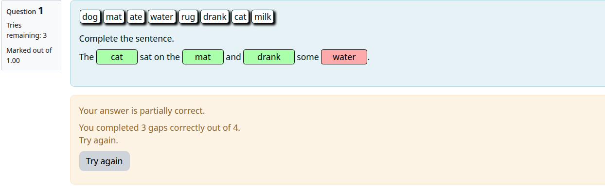

- When the quiz review options show the right answer, the correct answer
  appears after each incorrect gap. Alternatives are joined with "or" and
  `!!` is shown as "blank".

After the question is finished, with the right answer shown in the review:

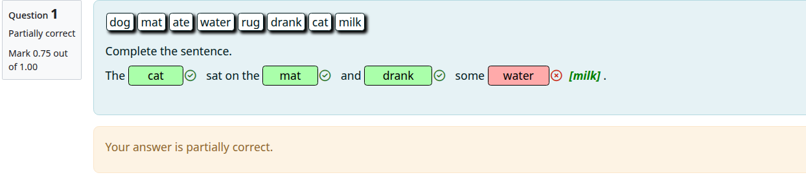

## Answering a question

In **dragdrop** mode students can:

- Drag an option into a gap, using a mouse or touch.
- Select an option with a click, tap, **Enter** or **Space**, then place it by
  clicking a gap or pressing **Enter** in a gap.
- Move text from a filled gap to another gap in the same way. If the target
  gap is already filled, the two gaps swap.
- Clear a gap by dragging its text back onto the answer options, or by
  selecting the gap and then choosing the options.
- Press **Escape** to cancel a selection.

Instructions are available in a collapsed **How to answer** section above the
options. Gaps are labelled for screen readers and each placement, move, swap
or clear is announced. Pressing **Enter** in a gap does not submit the quiz
page. Answers placed by dragging are picked up by quiz autosave.

In **dropdown** mode the student picks an answer from each list. In
**gapfill** mode the student types into each gap.

## In the Moodle app

Gapfill works in the Moodle mobile app, where it is loaded automatically as
a remote addon. Selection follows the pattern of the core Drag and drop into
text question type: instead of dragging, the student taps an answer to select
it and then taps a gap to place it. Tapping a gap without a selected answer
clears it. Selected options report their pressed state to screen readers.

## Tables with category columns

The `|` operator can be combined with an HTML table to make categorisation
exercises. Use the HTML view of the editor and give the table the class
`gapfilltable`:

```html
<table class="gapfilltable" border="2" rules="rows">
  <tbody>
    <tr><th>Feline</th><th>Canine</th></tr>
    <tr><td>[tiger|lion]</td><td>[dog|wolf]</td></tr>
    <tr><td>[tiger|lion]</td><td>[dog|wolf]</td></tr>
  </tbody>
</table>
```

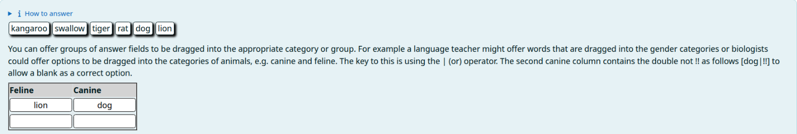

Combine with **No Duplicates** so that the same answer cannot score twice.
Using `<th>` cells for the first row shades the heading row; the
`gapfilltable` class is supplied by the question type's CSS.

## Tables with images

The same technique can pair images with gaps, for example a table with an
image in one column and a gap in the next, so students drag the name of each
picture into the gap beside it.

```html
<table class="gapfilltable" border="0">
  <tbody>
    <tr>
      <td></td>
      <td>[apple]</td>
    </tr>
    <tr>
      <td></td>
      <td>[pear]</td>
    </tr>
  </tbody>
</table>
```

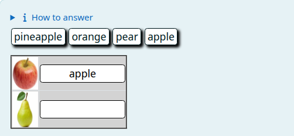

## Gapfill crossword

A crossword can be built from a table where each letter to guess is a
single character gap, e.g. `[T]`.

1. Write out the completed crossword on paper (graph paper helps).
2. Create a new Gapfill question and type any instructions, plus the Across
   and Down clues.
3. Build a table with the right number of rows and columns. It is easiest to
   create the grid with the editor and then tweak the HTML.
4. Leave empty cells empty. Fill the other cells with either a fixed
   character (as a help to the student) or the character to guess in square
   brackets. Clue numbers can go in their own cells.
5. Save, preview, fix any mistakes and try it as a student.

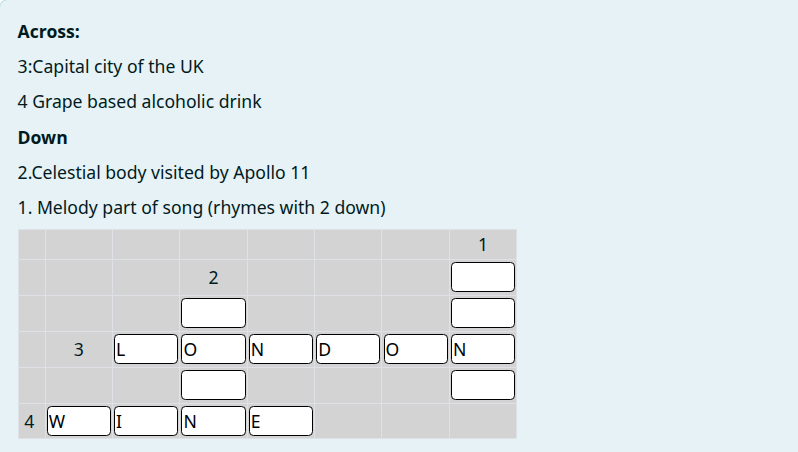

The `gapfillcol` class ships with the question type and sets the light grey
background among other things.

```html
<table class="text-center gapfillcol" border="1">
<tbody>
<tr><td></td><td></td><td></td><td></td><td></td><td></td><td></td><td>1</td></tr>
<tr><td></td><td></td><td></td><td>2</td><td></td><td></td><td></td><td>[T]</td></tr>
<tr><td></td><td></td><td></td><td>[M]</td><td></td><td></td><td></td><td>[U]</td></tr>
<tr><td> </td><td>3</td><td>[L]</td><td>[O]</td><td>[N]</td><td>[D]</td><td>[O]</td><td>[N]</td></tr>
<tr><td></td><td></td><td></td><td>[O]</td><td></td><td></td><td></td><td>[E]</td></tr>
<tr><td> 4 </td><td>[W]</td><td>[I]</td><td>[N]</td><td>[E]</td><td></td><td></td><td></td></tr>
</tbody>
</table>
```

## Extended characters

Gaps only work with characters that display in a standard HTML form field,
so HTML and LaTeX are not rendered inside a gap. Unicode characters do work,
for example:

```
What is ten to the power 3? [10³]
```

The following HTML entities can be used in gaps. Switch the editor to HTML
view (the `<>` button) to enter them, although most characters can also be
typed directly:

| Code | Character |
| --- | --- |
| `&nbsp;` | Non-breaking space |
| `&amp;` | `&` |
| `&apos;` | `'` |
| `&copy;` | © |
| `&plusmn;` | ± |
| `&times;` | × |
| `&divide;` | ÷ |
| `&gt;` | `>` |
| `&lt;` | `<` |
| `&laquo;` | « |
| `&lsquo;` | ‘ |
| `&rsquo;` | ’ |

## Site administration settings

Go to **Site administration > Plugins > Question types > Gapfill > Settings**
to set defaults for new questions:

| Setting | Effect |
| --- | --- |
| Disable Regex | Default for the Disable Regex option |
| Single use draggables | Default for the Single use draggables option |
| Fixed Gap Size | Default for the Fixed Gap Size option |
| Case Sensitive | Default for the Case Sensitive option |
| Options after text | Default for the Options after text option |
| Letter hints | Default for the Letter hints option |
| Add hint text to editing form | Fills the first two hints in the Multiple tries section with letter hint text |
| Delimit characters | The delimiter pairs offered on the editing form, comma separated. Default: `[ ],{ },# #,@ @`. For example add `% %` to allow `The %cat% sat on the %mat%`. |

The **Import** page in the same category imports the example questions (see
[Example questions](#example-questions)). It requires the
`moodle/site:config` capability.

## Prevent typing into gaps

In dragdrop mode students can normally also type into a gap. To force
students to drag (or select) answers, an administrator can add CSS through
**Site administration > Appearance > Additional HTML**
(`/admin/settings.php?section=additionalhtml`):

```html
<style>
.que.gapfill input.droptarget {
    text-align: center;
    cursor: pointer;
    pointer-events: none;
}
</style>
```

`pointer-events: none` does the work. This applies to every Gapfill question
on the site, and is only a style change, so a determined student could work
around it.

## Use in modules other than quiz

Gapfill works in any module that uses the Moodle question engine, including
the StudentQuiz activity.

## Related question types

- **Wordselect** – a companion question type by the same author, created the
  same way with square brackets around words. All the words are shown and
  the student clicks the correct ones. It ships with about 100 further
  English language questions that complement `english_language.xml`.
- **Embedded answers (Cloze)** – core question type with more features but a
  more complex syntax. Gapfill was designed to be simpler to use.
- **Drag and drop into text** – core question type.
- **Select missing words (gapselect)** – core question type using dropdowns.

## More information

- Moodle docs page: <https://docs.moodle.org/en/Gapfill_question_type>
- Change log: [changelog.md](../changelog.md)
- Source and issue tracker: <https://github.com/marcusgreen/moodle-qtype_gapfill>
